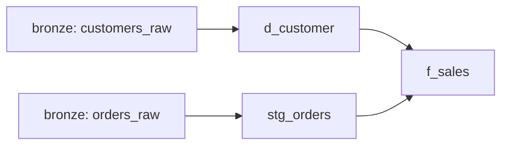

# f_sales

Daily sales by city, region and customer segment. This is what Snowflake loads into
the Gold table [`F_SALES_SUMMARY`](../../04_Gold/entities/f_sales_summary.md).

| Property | Value |
| --- | --- |
| Model file | `models/silver/f_sales.sql` |
| Materialisation | `table` |

## What it reads

<!-- auto:start reads model=f_sales -->
Bronze sources: none.

Silver models: [`d_customer`](d_customer.md), [`stg_orders`](stg_orders.md).
<!-- auto:end -->

## Lineage

<!-- auto:start lineage model=f_sales -->

<!-- auto:end -->

## Model SQL

<!-- auto:start model-sql model=f_sales -->
```sql
select
    o.order_dt                    as sale_dt,
    o.city_nm,
    o.region_cd,
    c.customer_segment,
    count(distinct o.order_id)    as order_cnt,
    sum(o.gross_amt)              as net_revenue_amt
from {{ ref('stg_orders') }} o
join {{ ref('d_customer') }} c
  on o.customer_id = c.customer_id
group by 1, 2, 3, 4
```
<!-- auto:end -->

## Business rules

- One row per day, city, region and customer segment.
- `net_revenue_amt` adds up the gross amount of every order on that day.
